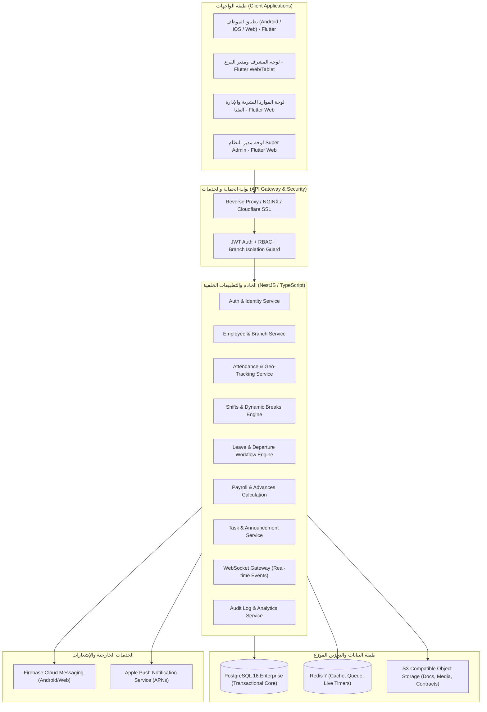
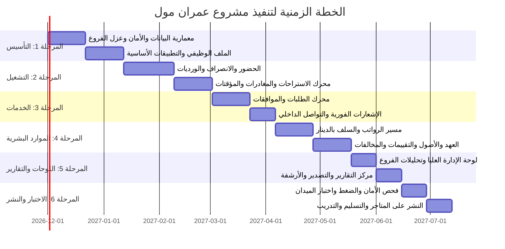

# وثيقة خطة التنفيذ الشاملة والتصميم المعماري والفني
## مشروع: عمران مول – المنصة المتكاملة لإدارة الموظفين والعمليات التشغيلية
### (OMARAN MALL MANAGEMENT SYSTEM)

---

## 1. الملخص التنفيذي ورؤية المشروع (Executive Summary)

يهدف مشروع **عمران مول** إلى بناء منصة مؤسسية موحدة ومتكاملة (Enterprise HR & Operations Management Platform) لإدارة دورة حياة الموظف والعمليات التشغيلية الميدانية في فروع المول من لحظة التعيين وحتى إنهاء الخدمة. 

النظام مصمم خصيصاً لتجاوز مفهوم "برنامج الحضور والانصراف التقليدي"، ليكون عصب التشغيل اليومي الذي يربط:
- **الموظفين** (عبر تطبيق هاتف وويب متقدم يقدم خدمات ذاتية ذكية).
- **المشرفين ومديري الفروع** (عبر لوحات مراقبة لحظية وإدارة ورديات واستراحات مرنة).
- **الإدارة العليا والموارد البشرية** (عبر تقارير تحليلية ومؤشرات أداء مركزية ورقابة مالية وإدارية).

### الثوابت الفنية والتشغيلية الإلزامية:
* **بيئة العمل واللغة:** اللغة العربية الأساسية (RTL) مع جاهزية كاملة للتعريب والإنجليزية (LTR).
* **العملة المعتمدة:** الدينار الأردني (JOD).
* **المنطقة الزمنية المرجعية:** `Asia/Amman`.
* **مبدأ العزل المتعدد الفروع (Multi-Branch Isolation):** عزل تام للبيانات والصلاحيات على مستوى قاعدة البيانات والخادم (Server-Level & DB-Level Isolation).
* **موثوقية العمل:** لا اعتماد على وقت جهاز العميل (Server-side time strictly enforced)، وتحديثات فورية دون إعادة تحميل الصفحة (Real-time WebSockets)، مع دعم جزئي للعمل بدون اتصال (Offline Sync).

---

## 2. البنية التقنية والهندسية (System Architecture)

### 2.1 التقنيات المستخدمة واختيارات المعمارية:
1. **الواجهات الأمامية (Frontend):**
   - **Flutter (Dart 3.x):** كود موحد لتطبيقات Android, iOS, و Web مع دعم أصلي كامل لـ Material 3 و RTL.
   - **Riverpod 2.x:** لإدارة الحالة المتماسكة (State Management) واختبارات الوحدة المنفصلة.
   - **GoRouter:** لإدارة التوجيه، المسارات العميقة (Deep Links)، وحماية المسارات حسب الدور (Role-Based Routing Guards).
2. **الخادم الخلفي (Backend):**
   - **NestJS (Node.js / TypeScript):** معمارية مؤسسية Modular قائمة على نمط Clean Architecture وحقن الاعتماديات (Dependency Injection).
   - **Prisma / TypeORM:** للتعامل مع قاعدة البيانات مع دعم المعاملات الذرية (ACID Transactions) والتهجير المنظم (Migrations).
   - **Socket.io / WebSockets:** لتحديث شاشات المديرين والمؤقتات اللحظية بدون Polling.
3. **قاعدة البيانات والتخزين:**
   - **PostgreSQL 16:** لتخزين البيانات العلائقية المعقدة، القيود (Constraints)، وفهارس البحث السريع وعزل الفروع.
   - **Redis:** لإدارة الجلسات، كاش الصلاحيات، طوابير الإشعارات (BullMQ)، وحسابات مؤقتات الاستراحة الحية.
   - **MinIO / AWS S3 Compatible Storage:** لتخزين مستندات الموظفين، العقود، والصور عبر روابط مؤقتة مشفرة (Presigned URLs).

---

## 3. هيكلية قاعدة البيانات الشاملة (Database Architecture & ERD)

تم تقسيم قاعدة البيانات إلى **40+ كياناً أساسياً** تضمن عدم تكرار البيانات مع فرض عزل الفروع `branch_id` وتطبيق التتبع الزمني الكامل (Audit Trails):

```mermaid
erDiagram
    COMPANIES ||--o{ BRANCHES : has
    BRANCHES ||--o{ DEPARTMENTS : contains
    DEPARTMENTS ||--o{ POSITIONS : defines
    BRANCHES ||--o{ EMPLOYEES : employs
    USERS ||--|| EMPLOYEES : links_to
    USERS ||--o{ USER_ROLES : has
    ROLES ||--o{ USER_ROLES : assigned_to
    ROLES ||--o{ ROLE_PERMISSIONS : contains
    
    EMPLOYEES ||--|| EMPLOYEE_PROFILES : has
    EMPLOYEES ||--o{ EMPLOYEE_CONTRACTS : signs
    EMPLOYEES ||--o{ EMPLOYEE_DOCUMENTS : owns
    EMPLOYEES ||--o{ EMPLOYEE_HISTORY : logs
    
    BRANCHES ||--o{ SHIFTS : schedules
    SHIFTS ||--o{ SHIFT_ASSIGNMENTS : assigned
    EMPLOYEES ||--o{ SHIFT_ASSIGNMENTS : works
    
    EMPLOYEES ||--o{ ATTENDANCE_RECORDS : registers
    ATTENDANCE_RECORDS ||--o{ ATTENDANCE_CORRECTIONS : has
    
    BRANCHES ||--o{ BREAK_POLICIES : configures
    BREAK_POLICIES ||--o{ BREAK_TYPES : specifies
    EMPLOYEES ||--o{ BREAK_REQUESTS : requests
    BREAK_REQUESTS ||--o{ BREAK_SESSIONS : tracks
    
    EMPLOYEES ||--o{ LEAVE_BALANCES : holds
    EMPLOYEES ||--o{ LEAVE_REQUESTS : requests
    EMPLOYEES ||--o{ DEPARTURE_REQUESTS : requests
    
    BRANCHES ||--o{ PAYROLL_PERIODS : runs
    PAYROLL_PERIODS ||--o{ PAYROLL_RECORDS : generates
    EMPLOYEES ||--o{ PAYROLL_RECORDS : receives
    EMPLOYEES ||--o{ LOANS : takes
    
    BRANCHES ||--o{ TASKS : creates
    TASKS ||--o{ TASK_ASSIGNMENTS : assigns
    EMPLOYEES ||--o{ TASK_ASSIGNMENTS : executes
    
    BRANCHES ||--o{ ASSETS : owns
    ASSETS ||--o{ ASSET_ASSIGNMENTS : distributed_to
    EMPLOYEES ||--o{ ASSET_ASSIGNMENTS : holds
```

### قائمة الجداول الرئيسية ووظائفها:
1. **الكيانات الإدارية:** `companies`, `branches`, `departments`, `positions`.
2. **المستخدمون والأمان:** `users`, `roles`, `permissions`, `user_roles`, `role_permissions`, `audit_logs`.
3. **ملفات الموظفين:** `employees`, `employee_profiles`, `employee_documents`, `employee_contracts`, `employee_history`.
4. **الورديات والجدولة:** `shifts`, `shift_assignments`, `shift_swap_requests`.
5. **الحضور الذكي:** `attendance_records`, `attendance_corrections`, `geo_fences`.
6. **الاستراحات والتحكم الحي:** `break_types`, `break_policies`, `break_requests`, `break_sessions`.
7. **المغادرات والإجازات:** `departure_requests`, `leave_types`, `leave_balances`, `leave_requests`.
8. **الرواتب والمالية:** `payroll_periods`, `payroll_records`, `allowances`, `deductions`, `loans`, `loan_installments`.
9. **العمليات والاتصال:** `tasks`, `task_assignments`, `announcements`, `announcement_reads`, `internal_messages`, `notifications`, `notification_preferences`.
10. **الأصول والتطوير والسلامة:** `assets`, `asset_assignments`, `training_courses`, `training_records`, `evaluations`, `violations`, `rewards`, `incidents`, `system_settings`, `approval_workflows`.

---

## 4. تفصيل الأنظمة والمحركات التشغيلية (Core Operational Engines)

### 4.1 محرك الحضور والانصراف المتقدم
- **تسجيل وقت الخادم (Server Time Source):** منع الاعتماد تماماً على توقيت الهاتف لتفادي التلاعب.
- **التحقق متعدد القنوات:**
  - كود QR ديناميكي يتغير كل 30 ثانية في الفرع.
  - نطاق جغرافي (Geo-Fencing) دائري ومضلع للفرع يُفحص فقط لحظة الضغط.
  - تسجيل بصمة الجهاز (Device Fingerprint / IMEI-hash) لمنع تسجيل موظف لزميله.
- **التصحيح الموثق:** تقديم طلب تصحيح عند النسيان يمر بدورة موافقة واضحة مع إبقاء السجل القديم والمعدل والسبب.

### 4.2 محرك الاستراحات الديناميكي والغداء والتدخين (Dynamic Breaks Engine)
- **أنواع الاستراحات القابلة للتخصيص الكامل:** غداء، قهوة، تدخين، طوارئ، استراحة خاصة.
- **قواعد منع التعارض (Concurrency & Anti-Conflict Rules):**
  - تحديد سقف الخروج المتزامن للقسم (مثلاً: لا يزيد عن 2 كاشير خارج الموقع في وقت واحد).
  - تحديد فترات الذروة الممنوعة (Blackout Periods).
  - الفاصل الزمني الإجباري بين استراحتين (Cool-down Period).
- **مؤقتات حية (Live WebSocket Timers):**
  - مؤقت عد تنازلي يظهر للموظف والمدير لحظياً.
  - إشعار قبل انتهاء الوقت بـ 3 دقائق، وإشعار عند الانتهاء، وتسجيل التأخير تلقائياً في حال تجاوزه.

### 4.3 محرك المغادرات والاستئذانات
- فصل تام بين "المغادرة الساعية" و"الإجازة اليومية".
- احتساب أثر المغادرة على ساعات العمل الفعلية (مدفوعة / مخصومة / معوضة) وفق صلاحيات المسؤول المعتمد.
- لوحة مراقبة حية للموجودين خارج الفرع ووقت عودتهم المتوقع.

### 4.4 نظام الإجازات وقانون العمل الأردني
- تخصيص سياسات الإجازات (سنوية، مرضية، عرضية، أمومة/أبوة، عطل رسمية، تعويضية).
- محرك احتساب وتراكم تلقائي للأرصدة مع إمكانية الترحيل السنوي.
- تقويم مركزي للفرع يكشف أي عجز تشغيلي قبل الموافقة على الإجازة.

### 4.5 نظام مسير الرواتب والسلف (Jordanian Payroll Engine)
- **العملة:** الدينار الأردني (JOD) مع دقة 3 خانات عشرية (فلس).
- **المعادلة الشهرية:** 
  $$\text{صافي الراتب} = (\text{الراتب الأساسي} + \text{البدلات} + \text{الإضافي} + \text{المكافآت}) - (\text{الغياب} + \text{التأخير} + \text{الضمان/الضرائب} + \text{أقساط السلف} + \text{الخصومات})$$
- إدارة السلف بخطط سداد مجدولة واقتطاع آلي من المسير الشهري.
- قفل الفترة المالية واعتمادها مع سجل تدقيق غير قابل للتعديل بعد الصرف.

### 4.6 محرك الإشعارات الفورية (Push Notification Orchestrator)
- دعم FCM و APNs مع قنوات صوتية مخصصة (Custom Notification Sounds) للحالات الحرجة.
- شارة عدد الإشعارات وتوجيه مباشر للشاشة المعنية بالحدث عند النقر.
- إعادة المحاولة الآلية (Backoff Retry Queue) في حال ضعف الاتصال.

---

## 5. خطة التنفيذ والمراحل (Phase Breakdown)

تم توزيع المشروع على **6 مراحل متكاملة** تضمن تقديم قيمة تشغيلية مبكرة مع بناء معماري صلب:

| المرحلة | المدة التقديرية | المخرجات الرئيسية | جهود التطوير |
|---|---|---|---|
| **المرحلة 1: البنية التحتية، الأمان، والملف الوظيفي** | 6 أسابيع | - إعداد PostgreSQL و Docker و NestJS - عزل الفروع ونظام الصلاحيات المركبة RBAC - شاشات تسجيل الدخول والملف الوظيفي الشامل للموظف - إنشاء وتوليد الأرقام الوظيفية المتسلسلة التلقائية | خادم: 120 ساعة واجهات: 110 ساعات فحص: 40 ساعة |
| **المرحلة 2: التشغيل اليومي (الحضور، الورديات، الاستراحات)** | 7 أسابيع | - محرك تسجيل الحضور والانصراف (QR + الجيوفنسينغ) - جدولة الورديات وتبديلها وكشف العجز - محرك الاستراحات والتدخين والمؤقتات اللحظية - نظام المغادرات والاستئذانات | خادم: 140 ساعة واجهات: 140 ساعة فحص: 50 ساعة |
| **المرحلة 3: الخدمات الذاتية، الموافقات، والتواصل** | 5 أسابيع | - مركز الخدمات الذاتية للموظف (20+ نوع طلب) - سير عمل الموافقات الديناميكي المتعدد المستويات - نظام الإعلانات والتعاميم الموثقة مع تأكيد القراءة - الرسائل الإدارية الداخلية والإشعارات الفورية FCM/APNs | خادم: 100 ساعة واجهات: 100 ساعة فحص: 40 ساعة |
| **المرحلة 4: شؤون الموظفين والرواتب والعمليات** | 6 أسابيع | - مسير الرواتب بالدينار الأردني وكشوف الرواتب والسلف - نظام الأصول والعهد ومحاضر التسليم والاستلام - إدارة التدريب والتطوير وتقييمات الأداء الدورية - سجل المخالفات والمكافآت وإدارة إنهاء الخدمة | خادم: 130 ساعة واجهات: 120 ساعة فحص: 50 ساعة |
| **المرحلة 5: لوحات التحكم المركزية والتقارير المتقدمة** | 4 أسابيع | - لوحة المراقبة اللحظية لمدير الفرع والمشرف - لوحة الإدارة العليا والتحليلات المقارنة بين الفروع - مركز التقارير الشامل والتصدير (Excel / PDF) - محرك البحث والأرشفة الذكية | خادم: 80 ساعة واجهات: 90 ساعة فحص: 35 ساعة |
| **المرحلة 6: الاختبارات الشاملة، النشر، والتدريب** | 4 أسابيع | - اختبارات الأمان وعزل الفروع (Penetration & RBAC testing) - اختبارات الحضور تحت الضغط المتزامن - النشر على متاجر Google Play و App Store وسيرفر الإنتاج - أدلة التشغيل وتدريب الكوادر وتسليم الملكيات الكاملة | تكامل: 80 ساعة اختبارات: 90 ساعة تدريب: 30 ساعة |

**إجمالي مدة المشروع التقريبية:** **32 أسبوعاً (حوالي 7.5 إلى 8 أشهر)** للتشغيل الكامل عالي الموثوقية.

---

## 6. الجدول الزمني لتوزيع العمل (Gantt Chart Roadmap)

---

## 7. تقدير التكلفة والميزانية التشغيلية (Cost & Budget Estimation)

> تم إعداد التقدير بالدينار الأردني (JOD) مع تقسيم التكاليف إلى تكلفة التطوير (مرة واحدة) والتكاليف التشغيلية السحابية السنوية/الشهرية:

### 7.1 تكلفة تطوير البرمجيات والتسليم (Software Development Costs):
تشمل الفريق البرمجي المخصص: (1 مهندس معمارية وأنظمة خلفية أول NestJS، 1 مهندس واجهات وتطبيقات أول Flutter، 1 مهندس فحص وجودة وأمان QA، 1 مصمم واجهات وتجربة مستخدم UI/UX).

| البند | التكلفة التقديرية الأدنى (JOD) | التكلفة الواقعية الموصى بها (JOD) | التكلفة القصوى مع الإضافات (JOD) |
|---|---|---|---|
| تصميم تجربة وواجهات المستخدم (UI/UX Design RTL) | 1,800 د.أ | 2,500 د.أ | 3,200 د.أ |
| تطوير وتأمين الخادم وقاعدة البيانات (Backend & APIs) | 6,500 د.أ | 8,200 د.أ | 10,500 د.أ |
| تطوير تطبيقات الهاتف والويب (Flutter Multiplatform) | 6,000 د.أ | 7,800 د.أ | 9,800 د.أ |
| محركات الوقت الفعلي والإشعارات والجيوفنسينغ | 1,800 د.أ | 2,400 د.أ | 3,000 د.أ |
| ضمان الجودة واختبارات الأمان واختبار الضغط (QA) | 1,500 د.أ | 2,100 د.أ | 2,800 د.أ |
| التوثيق، أدلة التشغيل، تدريب المديرين والموظفين | 800 د.أ | 1,200 د.أ | 1,600 د.أ |
| **المجموع الإجمالي لتطوير المشروع** | **18,400 د.أ** | **24,200 د.أ** | **30,900 د.أ** |

---

### 7.2 التكاليف التشغيلية الخارجية والسحابية (Cloud & Operational Infrastructure):

| الخدمة | نوع التكلفة | التكلفة التقديرية (شهرياً / سنوياً) | ملاحظات |
|---|---|---|---|
| خوادم الاستضافة والـ API والـ Redis (Render / AWS Lightsail) | شهري | 45 – 90 د.أ / شهرياً | قابلة للزيادة بزيادة عدد الفروع والموظفين |
| قاعدة بيانات مدارة مع نسخ احتياطي آلي (PostgreSQL Managed) | شهري | 35 – 70 د.أ / شهرياً | تتضمن استعادة الكوارث والنسخ الآلي اليومي |
| التخزين السحابي للمستندات والوثائق (S3 / Cloudflare R2) | شهري | 10 – 25 د.أ / شهرياً | تكلفة التخزين وعرض النطاق الترددي للوثائق |
| حساب Apple Developer Program | سنوي | ~71 د.أ ($99) / سنوياً | إلزامي لنشر تطبيق iOS |
| حساب Google Play Console | لمرة واحدة | ~18 د.أ ($25) لمرة واحدة | إلزامي لنشر تطبيق Android |
| النطاق وشهادات الأمان (Domain & SSL Wildcard) | سنوي | 25 – 50 د.أ / سنوياً | حماية كاملة لحركة البيانات |
| خدمة الرسائل القصيرة/WhatsApp API (اختياري للطوارئ) | بحسب الاستخدام | 20 – 40 د.أ / شهرياً | في حال الرغبة في تنبيهات SMS بديلة |

---

## 8. المتطلبات الخارجية المسبقة من إدارة عمران مول (External Dependencies)

لبدء المشروع دون تأخير أو توقف، يجب توفير أو إنشاء الحسابات الرسمية الآتية لتكون مملوكة للشركة بنسبة 100%:
1. **حسابات المتاجر الرسمية:**
   - حساب مطور آبل معتمد باسم الشركة (Apple Developer Account - Organization D-U-N-S).
   - حساب مطور جوجل بلاي (Google Play Console Organization).
2. **الاستضافة والسحابة:**
   - حساب مستقل على منصة الاستضافة (AWS / Render / DigitalOcean) ببطاقة دفع خاصة بالشركة.
   - حساب Cloudflare أو مزود DNS للتحكم في النطاق وحمايته من الهجمات.
3. **خدمات Firebase:**
   - مشروع Firebase رسمي مفعل عليه FCM للإشعارات السحابية ومربوط بحساب آبل وجوجل.
4. **الأصول البصرية والهوية:**
   - ملفات شعار عمران مول بجودة عالية (SVG/PNG بدقة موجهة)، والخطوط الرسمية والألوان المعتمدة.
   - اللائحة الداخلية للمول الخاصة بسياسات الدوام، الإجازات، العقوبات، والبدلات لاعتمادها في محرك الإعدادات.

---

## 9. التزامات الجودة وضمان معايير القبول (Acceptance & Handover Guarantee)

تلتزم خطة المشروع بجميع بنود "القسم الثامن والثلاثين" من وثيقة الشروط، والتي تشمل:
- **تسليم الكود المصدري الكامل (Full Source Code):** في مستودع Git رسمي ومحمي للشركة مع تاريخ التعديلات (Commit History) واضح ومنظم.
- **منع الواجهات الشكلية (Zero Dummy Code):** كل زر في النظام مربوط بمعاملات خلفية (Backend Transaction) حقيقية ومدققة.
- **أمان البيانات:** لا كلمات مرور أو مفاتيح سرية مخزنة داخل الكود المصدري، بل تتم إدارتها بالكامل عبر متغيرات بيئة آمنة (Environment Secrets).
- **التشغيل الميداني التجريبي:** فترة استقرار ومراقبة تشغيلية مدتها 30 يوماً بعد الإطلاق التجريبي لضمان استقرار العمل بدون أخطاء.
- **نقل الملكية:** تسليم جميع الحسابات وبيانات الاعتماد (Credentials) لتكون مسجلة حصرياً باسم الشركة وتحت إدارتها المستقلة.

---

# مستودع التطوير وخطة البدء

هذا المستودع هو المصدر الرسمي لكود مشروع عمران مول. وثيقة المتطلبات الأصلية أعلاه مرجع نطاق المشروع، والملفات التالية تضبط طريقة التنفيذ:

- [ميثاق المشروع](docs/PROJECT_CHARTER.md)
- [خطة التنفيذ المرحلية](docs/IMPLEMENTATION_ROADMAP.md)
- [خط أساس الأمان](docs/SECURITY_BASELINE.md)
- [معايير التطوير](docs/ENGINEERING_STANDARDS.md)
- [القرارات المعمارية](docs/ARCHITECTURE_DECISIONS.md)
- [تعريف الإنجاز ومعايير الإصدار](docs/DEFINITION_OF_DONE.md)
- [حالة المستودع والفجوات المعروفة](docs/CURRENT_STATE_AND_BLOCKERS.md)
- [دليل المساهمة](CONTRIBUTING.md)

## تشغيل بيئة التطوير المحلية

1. انسخ `backend/.env.example` إلى `backend/.env`، وغيّر كل قيمة placeholder إلى قيمة محلية قوية وفريدة.
2. من مجلد `backend` شغّل `docker compose up -d omran-postgres omran-redis`.
3. شغّل Backend بعد تثبيت الاعتماديات: `npm install` ثم `npm run start:dev`.
4. من مجلد `client` شغّل `flutter pub get` ثم `flutter run` على المنصة المطلوبة.

هذه خطوات تهيئة أولية وليست دليلاً على نجاح التشغيل؛ يجب أولاً إكمال مراجعة قاعدة البيانات وإضافة الاختبارات والـ migrations. لا تستخدم هذه البيئة أو بيانات seed كنظام إنتاج.

## تنبيه
لا ترفع `.env` أو مفاتيح Firebase/APNs أو S3 أو أي بيانات موظفين إلى Git. لا تنشر النظام قبل إغلاق الفجوات المسجلة في [حالة المستودع](docs/CURRENT_STATE_AND_BLOCKERS.md).
