# مخطط العلاقات وقاعدة البيانات (Entity Relationship Diagram - ERD)
## نظام عمران مول لإدارة الموظفين والعمليات التشغيلية (OMARAN MALL)

```mermaid
erDiagram
    COMPANIES ||--o{ BRANCHES : "تمتلك فروع"
    BRANCHES ||--o{ DEPARTMENTS : "تحتوي أقسام"
    DEPARTMENTS ||--o{ POSITIONS : "تحدد المسميات"
    BRANCHES ||--o{ EMPLOYEES : "توظف"
    DEPARTMENTS ||--o{ EMPLOYEES : "تضم"
    POSITIONS ||--o{ EMPLOYEES : "يشغل"
    
    USERS ||--o| EMPLOYEES : "يرتبط بـ"
    COMPANIES ||--o{ ROLES : "تحدد الأدوار"
    ROLES ||--o{ ROLE_PERMISSIONS : "تتضمن"
    PERMISSIONS ||--o{ ROLE_PERMISSIONS : "تمنح لـ"
    USERS ||--o{ USER_ROLES : "يحمل أدوار"
    ROLES ||--o{ USER_ROLES : "تعين لـ"
    BRANCHES ||--o{ USER_ROLES : "نطاق الفرع"
    
    EMPLOYEES ||--|| EMPLOYEE_PROFILES : "ملف شخصي"
    EMPLOYEES ||--o{ EMPLOYEE_CONTRACTS : "عقود"
    EMPLOYEES ||--o{ EMPLOYEE_DOCUMENTS : "وثائق"
    EMPLOYEES ||--o{ EMPLOYEE_HISTORY : "سجل وظيفي"
    
    BRANCHES ||--o{ SHIFTS : "تعرف ورديات"
    SHIFTS ||--o{ SHIFT_ASSIGNMENTS : "تجدول"
    EMPLOYEES ||--o{ SHIFT_ASSIGNMENTS : "يعين في"
    
    EMPLOYEES ||--o{ ATTENDANCE_RECORDS : "تسجيلات دوام"
    BRANCHES ||--o{ ATTENDANCE_RECORDS : "حضور الفرع"
    ATTENDANCE_RECORDS ||--o{ ATTENDANCE_CORRECTIONS : "طلبات تصحيح"
    
    BRANCHES ||--o{ BREAK_TYPES : "تحدد استراحات"
    BREAK_TYPES ||--o{ BREAK_REQUESTS : "تطلب كـ"
    EMPLOYEES ||--o{ BREAK_REQUESTS : "يطلب"
    BREAK_REQUESTS ||--o| BREAK_SESSIONS : "جلسة مؤقت حي"
    
    LEAVE_TYPES ||--o{ LEAVE_BALANCES : "أرصدة إجازة"
    EMPLOYEES ||--o{ LEAVE_BALANCES : "يملك رصيد"
    EMPLOYEES ||--o{ LEAVE_REQUESTS : "يقدم إجازة"
    LEAVE_TYPES ||--o{ LEAVE_REQUESTS : "نوع الإجازة"
    EMPLOYEES ||--o{ DEPARTURE_REQUESTS : "يقدم مغادرة"
    
    BRANCHES ||--o{ PAYROLL_PERIODS : "فترات رواتب"
    PAYROLL_PERIODS ||--o{ PAYROLL_RECORDS : "كشوف رواتب"
    EMPLOYEES ||--o{ PAYROLL_RECORDS : "كشف الموظف"
    EMPLOYEES ||--o{ LOANS : "سلف شخصية"
    LOANS ||--o{ LOAN_INSTALLMENTS : "أقساط السداد"
    
    BRANCHES ||--o{ TASKS : "مهام الفرع"
    TASKS ||--o{ TASK_ASSIGNMENTS : "تعيين مهام"
    EMPLOYEES ||--o{ TASK_ASSIGNMENTS : "ينفذ"
    
    BRANCHES ||--o{ ASSETS : "أصول وعهد"
    ASSETS ||--o{ ASSET_ASSIGNMENTS : "تسليم عهدة"
    EMPLOYEES ||--o{ ASSET_ASSIGNMENTS : "مستلم العهدة"
    
    USERS ||--o{ NOTIFICATIONS : "إشعارات المستخدم"
    USERS ||--|| NOTIFICATION_PREFERENCES : "تفضيلات الإشعار"
    
    USERS ||--o{ AUDIT_LOGS : "سجل التدقيق"
    BRANCHES ||--o{ AUDIT_LOGS : "تدقيق عمليات الفرع"
```

### قواعد العزل الصارمة (Multi-Branch Strict Isolation):
1. كل جدول تشغيلي يحتوي على عمود إلزامي `branch_id UUID REFERENCES branches(id)`.
2. يتم تطبيق فلترة البيانات على مستوى الاستعلام في الخادم عبر `BranchIsolationInterceptor` في NestJS، بحيث لا يرى مدير أو مشرف الفرع أية سجلات لفرع آخر حتى لو تم استدعاء الـ API مباشرة.
3. الإدارة العليا ومدير النظام (Super Admin) يمتلكان صلاحية `company` و `ALL_BRANCHES` لعرض التقارير المجمعة عبر الفروع.
